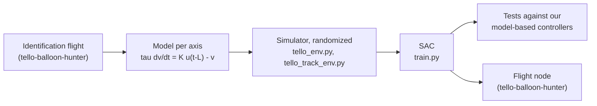

# tello-rl

Reinforcement learning for a DJI Tello, trained on the response identified in flight. The chain of "Learning to Fly
in Seconds" (Eschmann, Albani, Loianno, RA-L 2024) at the level the Tello accepts: its firmware is closed and only
takes velocity commands (`rc`, 20 Hz), so the policy commands velocities, not motors. Training side of
[tello-balloon-hunter](https://github.com/clementdumeril/tello-balloon-hunter) (EECS C106A/206A final project),
which identifies the drone, localizes it with ArUco markers and an EKF, and flies the policy.



- **Model** (identification flight of Nov 11, 2026): x K 1.25, tau 0.55 s; y K 1.09, tau 0.55 s; z K 0.78, tau 0.45 s;
  0.30 s from command to motion. Each training flight draws K (0.9–1.4, z 0.6–1.0), tau (0.4–0.8 s), the command
  delay (0.2–0.4 s), a drift up to 10 cm/s that wanders, EKF noise, and rounds the commands to the driver's rc step.
- **Tasks**: hold a point up to 2 m away (`tello_env.py`, 35 inputs); follow a point on circles and figure-eights or
  hold it (`tello_track_env.py`, 41 inputs: also the point's velocity and its position 0.5 s ahead).
- **Reward**: the form of RLtools' L2F reward, norms of the errors: 2 − (2 |e| + 0.1 |v − v_ref| + 0.5 |Δu| +
  0.1 |u|²), clipped at −2, optionally + a closeness bonus exp(−(|e| / 0.15 m)²); leaving the point ends the flight
  with −2 / (1 − γ).
- **Training**: SAC (Stable-Baselines3), actor 64 × 64 as in L2F, critics 256 × 256, γ 0.99, 4 environments.

## Results (simulation)

First training, point hold (`results/hold_v1`, Savio job 41221709, 500k steps, one update per 4 transitions, no bonus,
5 seeds), 100 flights to a point up to 2 m away:

| | Flights completed | RMS error over the last 5 s | Within 10 cm at the end |
| --- | --- | --- | --- |
| Policy, identified model | 100 % | 20.6 ± 3.7 cm (13.6–24.5) | 11 % |
| Policy, randomized model | 100 % | 20.7 ± 1.4 cm | 8 % |
| Our model-based hold, randomized model | 100 % | 4.2 cm | 100 % |

The policy never loses the drone but stops 5–20 cm short of the point, with commands of about one rc step; it made
only 125k network updates. Running: one update per transition, the closeness bonus, and the circle and figure-eight
task (`slurm/train_v2.slurm`, `slurm/train_track.slurm`). No flight with a policy yet.

## Run

```bash
pip install gymnasium stable-baselines3 torch
python train.py --steps 500000 --seed 0 --gradient-steps 4 --bonus 1 --out runs/hold          # point hold
python train.py --task track --steps 500000 --seed 0 --gradient-steps 4 --out runs/track       # circles, eights
python evaluate.py runs/hold/actor.npz            # or evaluate_track.py for a tracking policy
sbatch slurm/train_track.slurm                    # Savio: 10 seeds
```

Each run writes `config.json`, `progress.csv`, `model.zip`, `actor.npz` (the actor as numpy arrays, for the flight
node) and `evaluation.json`.

## Fly a policy on the Tello

The flight node is `ros/rl_hold.py` (a ROS 2 node using tello-balloon-hunter's driver, EKF and safety chain); it is
kept here so that tello-balloon-hunter stays free of RL code. To fly, copy it and `rl_paths.py` into
`tello-balloon-hunter/src/tello_driver/tello_driver/`, add `"tello_rl_hold = tello_driver.rl_hold:main"` to the
`console_scripts` of its `setup.py`, rebuild, then:

```bash
ros2 run tello_driver tello_rl_hold --ros-args -p actor:=<path>/actor.npz
```

`rl_paths.py` builds the observation: the copy next to the flight node must stay identical to the one used for
training.
